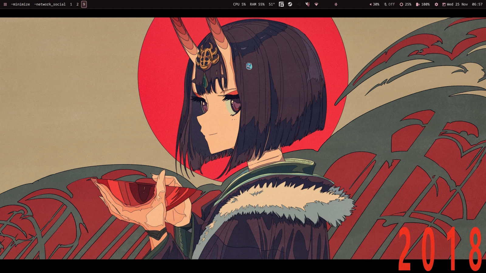
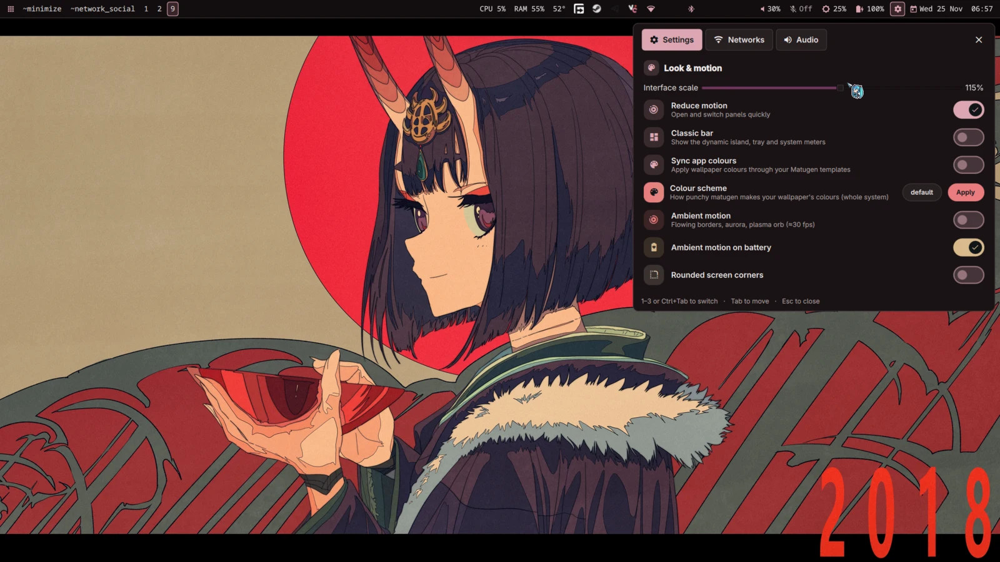
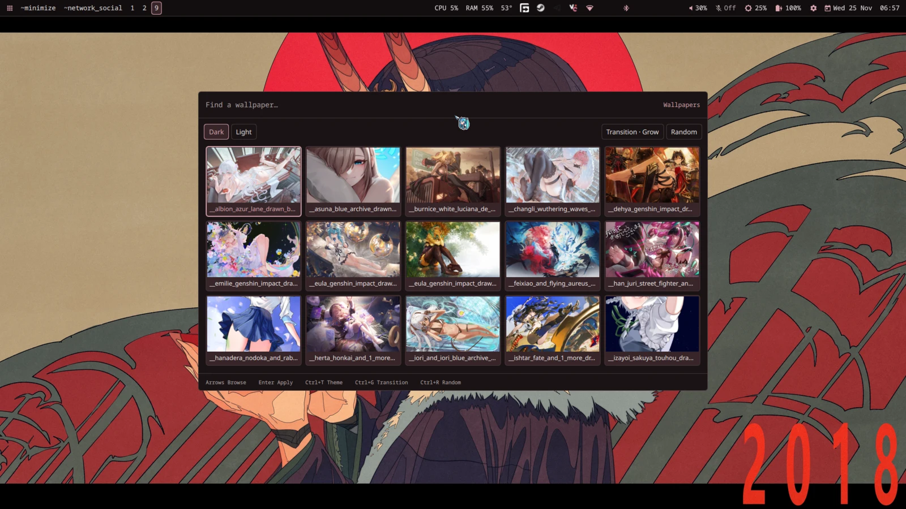
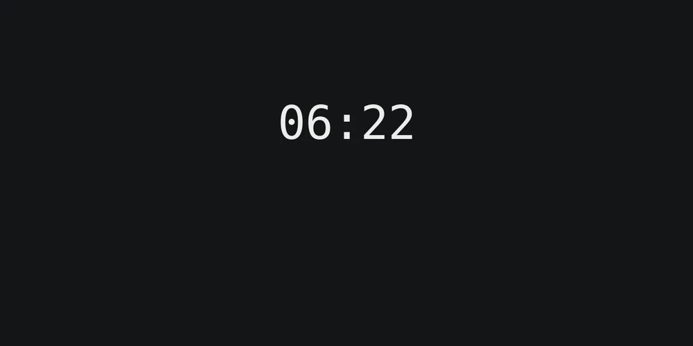

# Minimalistic Prism

A keyboard-first Quickshell setup for Hyprland 0.55+ with Lua configuration and Quickshell 0.3.2+. The thin, interactive bar shows workspaces, the focused window, CPU and RAM, network, Bluetooth, volume, microphone, brightness, battery, and the clock. Reduced motion is enabled by default.

## Screenshots



**Settings**



**Wallpaper picker**



**Lock screen**



## Install and run

From a checkout, run `./install.sh` to copy the shell into `${XDG_CONFIG_HOME:-$HOME/.config}/quickshell`. Use `./install.sh --dry-run` to preview the install or `./install.sh --packages` to install dependencies with Pacman on Arch. If the destination already contains a different Quickshell configuration, `--replace` backs it up and carries over its settings and state.

From this folder, run `qs --no-duplicate --path .`. Open the palette from another terminal in the same folder with `qs --path . ipc call launcher toggle`.

The shell creates `config.json` on first launch. It stores local preferences such as Quick Edit folders and editor settings. Git ignores this file along with the shell's cache and state directories.

To use the optional sample keymap, load it after your other Hyprland bindings.

```lua
dofile(os.getenv("HOME") .. "/.config/quickshell/hypr/minimal-binds.lua")
```

For autostart, use `hl.exec_cmd("qs --no-duplicate")` in your `hyprland.start` handler. If you already start `quickshell` there, that entry also works.

## Keyboard shortcuts

Each IPC call starts with `qs ipc call`. The table lists common actions and their shortcuts.

| Shortcut | IPC call | Action |
| --- | --- | --- |
| `Super+S` | `launcher toggle` | Search and launch apps |
| `Super+Shift+Tab` | `switcher toggle` | Switch windows with live previews, with the previous window selected |
| `Super+V` | `clipboard toggle` | Search and copy clipboard history with image previews |
| `Super+Alt+W` | `wallpaper toggle` | Browse image previews and adjust appearance |
| `Super+Alt+P` | `screenshot menu` | Open the frozen-screen capture tool |
| `Super+Escape` / `Super+Shift+Escape` | `preferences toggle` / `controls toggle` | Open the compact settings popup / quick controls |
| `Super+/` | `cheatsheet toggle` | Search Hyprland and palette shortcuts full-screen |
| `Super+.` | `emoji toggle` | Search and copy an emoji |
| `Super+N` | `calendar toggle` | Open the calendar |
| `Super+K` | `clock toggle` | Open the floating clock, alarms, timers and stopwatch |
| `Super+Shift+Q` | `edit toggle` | Open or manage Quick Edit folders |
| `Super+M` | `power toggle` | Open power and session actions |
| `Super+L` | `lock lock` | Lock with Hyprlock and show a simple clock |
| Volume up key | `osd volumeUp` | Raise output volume |

The [sample keymap](hypr/minimal-binds.lua) also assigns `Super+O` to the live workspace overview and `Super+Space` to commands. From `Super+S`, type `/` to search all shell actions or `:` to jump straight to a workspace. The [full IPC list](action_commands.md) covers direct commands for recording, timers, media, brightness and other functions.

## Palette navigation

Type to filter. Use `↑` / `↓`, `Ctrl+K` / `Ctrl+J`, or `Ctrl+P` / `Ctrl+N` to move, `Enter` to select, and `Esc` to close. `Tab` / `Shift+Tab` and `Ctrl+1` through `Ctrl+5` switch between apps, windows, workspaces, clipboard and commands. From a blank app search, type `@` for windows, `:` for workspaces, `>` for clipboard, `/` for commands, or `w` followed by Space for wallpapers. `Ctrl+E` opens emoji and `Ctrl+U` clears the query. In Workspaces, enter a number to open an empty workspace.

Type `=` for the calculator, `$` for shell commands, `#` for web search, `y` followed by Space for YouTube, or `?` for launcher help.

## Bar and popup

Click a workspace to switch to it. Click Wi-Fi or Bluetooth for Networks, the speaker or microphone for Audio, and the gear for Settings. Scroll over the speaker or brightness to adjust it. Right-click the speaker or microphone to mute it. Hover over a status item to see details.

Click the date and time or press `Super+N` to open the calendar. Use `←` / `→` to change months and `Home` to return to today. Right-click the date and time for the floating clock.

In the settings popup, `Ctrl+Tab` cycles Settings, Networks and Audio. `Alt+1` through `Alt+3` jump to a tab. Use `Tab` to focus controls and `Esc` to close.

Use **Interface scale** under **Look & motion** to resize the compact bar, palette, and popups from 75% to 150%. The shell saves the setting in `config.json`.

## Wallpapers and desktop tools

In Quick Edit, press `A` or click **Add folder**. Paste a path and press `Enter`, or use **Browse** to pick a folder. Press `Delete` on the selected row or click its trash icon to remove the shortcut. Quick Edit saves the list in `config.json`.

The wallpaper picker searches `~/wallpapers`, `~/Pictures/Wallpapers` and `~/Videos/Wallpapers` by default, including their subfolders. Set `PRISM_WALLPAPER_DIR` to use a different library. Use the arrow keys to browse image and video previews and `Enter` to apply. `Ctrl+T` switches Dark and Light, `Ctrl+G` cycles Instant, Fade, Wipe, Grow and Wave, and `Ctrl+R` picks a random image. The picker uses `awww` for images and `mpvpaper` for videos. Appearance choices are saved. Enable **Sync app colours** in Settings to use your existing Matugen templates.

Use `qs ipc call wallpaper random` for a random image or `qs ipc call wallpaper set "/absolute/path/to/image.jpg"` to apply a specific one. `awww-daemon` must be running.

The screenshot tool freezes the focused screen. Drag an area or click a window, then choose Copy, Save, or Copy and save. `Tab` switches between area and window modes. Arrows move the selection and `Shift+arrows` resize it. `Enter` copies and saves the selection or the whole screen, `Ctrl+C` copies, `Ctrl+S` saves, `C` opens the colour picker, and `Esc` cancels. Screenshots use `grim` and ImageMagick and save to `~/Pictures/Screenshots` by default. Colour picking uses `hyprpicker`.

## Panels and services

- Networks includes Wi-Fi and Bluetooth, and Audio includes input and output devices and per-app volume. The optional screen-time tracker is available through **Screen Time App** when `paths.screentime` is configured.
- Quick controls include volume, brightness, media, caffeine, focus, warm screen and game mode. Shell reminders and recording results use the session's notification provider when one is available.
- Search for **Recording controls** or use `qs ipc call record menu` to record an area, window or output with `wf-recorder`. **Focus Timer** and **Clock** are searchable actions. Clock alarms and timers run while the window is closed.
- Settings includes **Reduce motion** and **Classic bar**. The classic bar uses a three-pill layout and dynamic island.

Clipboard history uses `cliphist` and `wl-clipboard`. Start `wl-paste --watch cliphist store` in Hyprland to collect history. Live wallpaper previews use FFmpeg. Media and audio integrate with MPRIS and PipeWire. Lock uses Hyprlock by default and the Settings tab can enable the built-in lock screen.
